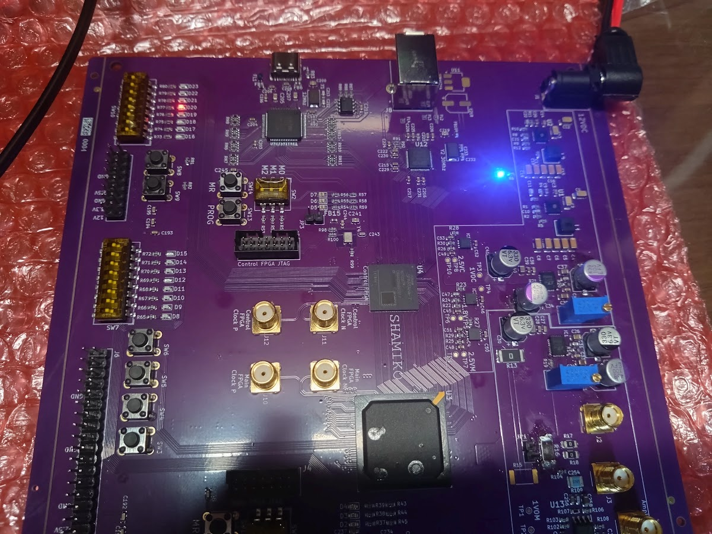

# SHAMIKO



**SHAMIKO: an open-source side-channel analysis board with dual Xilinx Spartan-7 FPGAs**

SHAMIKOは、SAKURA-Gと同等の機能を実現することを目標として開発された、電力解析攻撃（サイドチャネル攻撃）の実験用FPGA基板です。Xilinx Spartan-7を搭載しており、ISEではなく最新のVivadoを用いた開発が可能です。

回路図・基板設計データ・プロジェクト固有ライブラリを含むすべての設計データをKiCad形式で公開しており、自由に改変できます。Main FPGA部分を自作ICに置き換えて電力解析を行うといったカスタマイズも可能です。

## Features

- **Dual FPGA構成** — 制御・PC通信用のControl FPGAと、解析対象回路を実装するMain FPGA（いずれもXilinx Spartan-7）
- **Vivado対応** — 最新のVivado / Vitisによる開発が可能
- **電力測定回路** — Main FPGAのコア電源ラインにシャント抵抗を挿入。SAKURA-G同等のオンボードアンプ、またはシャント抵抗両端のBNC端子から直接、オシロスコープで消費電力を観測可能
- **低ノイズ電源設計** — DC-DC + LDOの二段降圧、Control / Main独立の1.0V電源系統
- **柔軟な測定対象切り替え** — 0Ωジャンパ抵抗によりVCC_INTのみ / VCC_INT + VCC_BRAMの測定を選択可能
- **高速PC通信** — FT600（パラレルバス）およびFT2232H（UART / FIFO）を搭載
- **完全オープンソース** — KiCadプロジェクト一式（回路図・基板・ライブラリ）を公開

## Revision Status

| Revision | Status |
|---|---|
| Rev Alpha | 製造済み・評価中 |
| Rev Beta | 設計中（未製造） |
| Rev 1.0 | Rev Betaの動作確認後にリリース予定 |

## Repository Structure

```
SHAMIKO-board/
├── hardware/       # KiCadプロジェクト（回路図・基板・ライブラリ）
├── docs/
│   ├── manual/     # 説明書（LaTeXソース・Markdown）
│   ├── schematic.pdf
│   └── images/
└── LICENSE
```

## Getting Started

### 設計データ

`hardware/` 以下のKiCadプロジェクトから回路図・基板データを閲覧できます。

ガーバーデータおよびBOMは、製造・動作確認が完了し次第公開予定です。それまでに製造したい場合はKiCadから各自出力してください。

### 開発環境

- **FPGA開発**: AMD (Xilinx) Vivado
- **基板設計**: KiCad

### 電源

外部ACアダプタ（12V）から給電します。電源シーケンスは基板上で自動的に制御されます。

## Documentation

詳細な仕様（電源システム、クロック、コンフィグレーション、ピンアサインなど）は説明書を参照してください。

- 説明書PDF: [Releases](https://github.com/SHAMIKO-project/SHAMIKO-board/releases) に添付
- Markdown版: `docs/manual/`

## Sample Designs / Host Software

サンプルHDL（暗号実装例）およびホストPC側の通信ソフトウェアは現在準備中です。Coming soon.

## Contact

- 不具合報告・質問: [GitHub Issues](https://github.com/SHAMIKO-project/SHAMIKO-board/issues)
- Discordコミュニティ: Coming soon

## Developers

- Hirata Haruka
- Ohara Ryotaro

## License

このプロジェクトは [MIT License](LICENSE) の下で公開されています。

## Acknowledgements

- [SAKURA-G](http://satoh.cs.uec.ac.jp/SAKURA/hardware/SAKURA-G.html) — サイドチャネル攻撃評価用FPGA基板の先駆的プロジェクト。SHAMIKOはSAKURAプロジェクトとは無関係の独立したプロジェクトですが、この分野を切り拓いた偉大な仕事に畏敬の念を込めて、設計目標の基準とさせていただきました。

---

*English version: [README.en.md](README.en.md)*